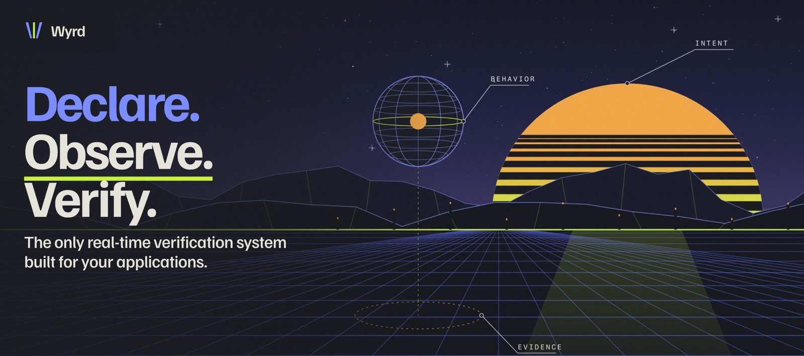
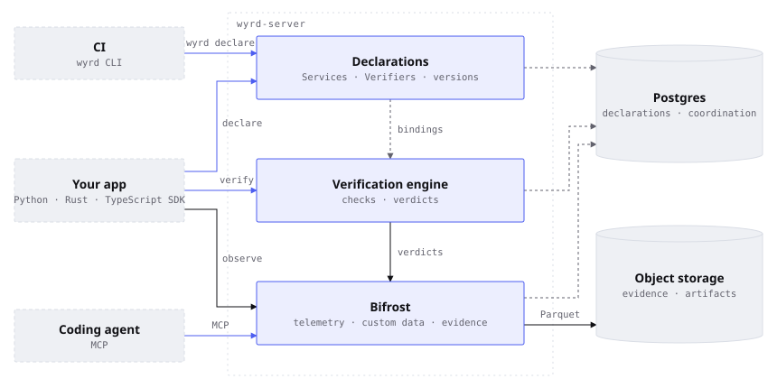

<p align="center">
  <a href="https://docs.bohmian.ai/wyrd/"></a>
</p>

<p align="center">
  <a href="https://github.com/bohmian-ai/wyrd/actions/workflows/lints-test.yml"></a>
  <a href="https://pypi.org/project/wyrd-ai/"></a>
  <a href="https://www.npmjs.com/package/wyrd-ai"></a>
  <a href="LICENSE.md"></a>
  <a href="https://discord.gg/K5bf23yPNb"></a>
</p>

<p align="center">
  <a href="https://docs.bohmian.ai/wyrd/"><b>Documentation</b></a> ·
  <a href="https://docs.bohmian.ai/wyrd/get-started/quickstart/">Quickstart</a> ·
  <a href="https://discord.gg/K5bf23yPNb">Discord</a>
</p>

## The only real-time verification system built for your applications.

Every system has its own requirements, workflows, and definitions of correct behavior. Turning them into repeatable checks usually means stitching together evaluation frameworks, observability tools, custom scripts, and data pipelines.

Wyrd gives you open-source building blocks for your own verification systems. **Declare** requirements. **Observe** real behavior. **Verify** live, during execution, or continuously over time.

Live verification puts the verdict before the decision. Your application asks Wyrd whether what it is about to do meets your requirements, gets an evidence-backed verdict for each one, and decides what happens next. The same verdicts are available from queued and continuous checks.

## Get started

A support agent answers a customer, and Wyrd verifies the answer before the customer sees it. The Verifier has two requirements: a text check, and an AI judge that reads the refund policy.

You need PostgreSQL 16, Python 3.11, and an OpenAI API key. Install Wyrd and the OpenAI client:

```bash
uv init support && cd support
uv add "wyrd-ai==0.4.2" openai
export OPENAI_API_KEY=sk-...
```

Start a local server in its own terminal. Enter your database URL and a tenant name, and accept the offer to add OpenAI:

```bash
uv run wyrd init
```

Save this as `support_agent.py`:

<!-- example: examples/support-agent/support_agent.py -->
```python
from openai import OpenAI
from pydantic import BaseModel
from wyrd import WyrdState
from wyrd.verify import (
    Agent,
    Check,
    ComparisonOperator,
    ExecutionRoute,
    Prompt,
    Requirement,
    ResponseFormat,
    Service,
    Verifier,
)

POLICY = "Refunds are possible within 30 days of purchase. Never promise a refund."


# The evidence the application sends for each reply.
class Reply(BaseModel):
    question: str
    answer: str


# The judge: a model that reads the reply and decides whether it follows the
# policy. Wyrd runs it through the `openai` gateway deployment.
policy_judge = Agent(
    "policy-judge",
    prompt=Prompt.openai_chat(
        "gpt-4o-mini",
        messages=f"Policy: {POLICY} Does this support answer follow the policy? "
        "Question: {{question}} Answer: {{answer}}",
        response_format=ResponseFormat.verdict(),
    ),
    execution_route=ExecutionRoute.wyrd_gateway(deployment="openai"),
)

# The Verifier: two requirements every reply must meet.
reply_check = Verifier(
    "reply-check",
    inputs=Reply,
    requirements=[
        Requirement(
            "no-refund-promise",
            "The answer never promises a guaranteed refund.",
            Check.assert_("inputs.answer", ComparisonOperator.NotContains, "guaranteed refund"),
        ),
        Requirement(
            "follows-policy",
            "The answer follows the refund policy.",
            Check.agent(policy_judge).inputs(
                {"question": "inputs.question", "answer": "inputs.answer"}
            ),
        ),
    ],
)

# Declare the Cards and get a ready state.
state = WyrdState.declare(Service("support", verified_by=[reply_check]))
model = OpenAI()


# Your support agent: any model call.
def support_agent(question: str) -> str:
    completion = model.chat.completions.create(
        model="gpt-4o-mini",
        messages=[
            {"role": "system", "content": f"You are a support agent. {POLICY}"},
            {"role": "user", "content": question},
        ],
    )
    return completion.choices[0].message.content or ""


question = "I bought this 45 days ago. Can I get my money back?"
# The agent's reply, and a reply that breaks the policy.
for answer in (support_agent(question), "Yes, you have a guaranteed refund."):
    with state.run() as run:
        result = run.observe.verify("reply-check", Reply(question=question, answer=answer))
    print(f"{result.verdict}: {answer}")
    for requirement in result.requirements:
        if requirement["outcome"] != "passed":
            print(f"  {requirement['id']}: {requirement['reason']}")
state.shutdown()
```

Run it:

```bash
uv run support_agent.py
```

<!-- example: examples/support-agent/output.txt -->
```text
passed: Refunds are possible within 30 days of purchase, so this order no longer qualifies.
failed: Yes, you have a guaranteed refund.
  no-refund-promise: operator NotContains returned false
  follows-policy: the answer promises a refund the policy does not allow
```

The agent's reply passes. The policy-breaking reply fails both requirements, and each failure gives its reason. The model's wording varies from run to run.

The same example is in [Rust](examples/support-agent/support_agent.rs) and [TypeScript](examples/support-agent/support_agent.ts); [Set up Wyrd](https://docs.bohmian.ai/wyrd/get-started/setup/) has their install commands. The Cards can also be declared as [YAML](https://docs.bohmian.ai/wyrd/understand/how-verification-works/#code-or-yaml), the recommended route in production. [Run your first verification](https://docs.bohmian.ai/wyrd/get-started/quickstart/) goes further: a judge that reads a policy PDF, and a verdict your application acts on.

## What you can build

The same primitives build other verification. Start from a use case:

<p align="center">
  <a href="https://docs.bohmian.ai/wyrd/get-started/what-can-i-build/#runtime-verification"></a>
  <a href="https://docs.bohmian.ai/wyrd/get-started/what-can-i-build/#policy-verification"></a>
  <a href="https://docs.bohmian.ai/wyrd/get-started/what-can-i-build/#agent-evaluation"></a>
  <a href="https://docs.bohmian.ai/wyrd/get-started/what-can-i-build/#long-horizon-workflows"></a>
  <a href="https://docs.bohmian.ai/wyrd/get-started/what-can-i-build/#drift-monitoring"></a>
</p>

[What can I build?](https://docs.bohmian.ai/wyrd/get-started/what-can-i-build/) walks through each one.

## How Wyrd fits your stack

<picture>
  <source media="(prefers-color-scheme: dark)" srcset=".github/assets/wyrd-stack-dark.svg">
  
</picture>

1. **Declare.** Describe what you ship in YAML and bind Verifiers to it, from CI with `wyrd declare` or from your code. Each declaration has a version, so a changed prompt is a new version.
2. **Observe.** Your app sends Bifrost, Wyrd's data plane, the telemetry, data, and evidence you choose to record. Bifrost keeps all of it queryable with SQL beside every verdict.
3. **Verify.** Your app sends a result to a Verifier and gets a verdict for each requirement, with a reason.

The Python, Rust, and TypeScript SDKs, the CLI, MCP, and HTTP all call one server, so a verdict reads the same from each. [Architecture](https://docs.bohmian.ai/wyrd/understand/architecture/) shows what a team deployment runs.

## Why Wyrd

Most AI tools hand you their evaluators, their UI, and their datastore. Your checks end up shaped by what the product supports, and your evidence lives where the product keeps it.

Wyrd gives you the primitives instead, and you build the verification layer your system needs: a code reviewer that reads the diff and your style guide, a payment check that cites your policy document, drift on a classical model, a check across a six-hour agent run.

## Already have tools?

Keep them. Add Wyrd where they stop.

| You use | Keep it for | Add Wyrd for |
| --- | --- | --- |
| MLflow, W&B | Training, experiments, model registry | Runtime monitoring and verification of the model you deployed, at its exact version |
| Langfuse, Phoenix, LangSmith | Trace exploration, prompt iteration | Your own verification layer: checks you compose, judges with tools and your files, verdicts your app acts on |
| promptfoo, DeepEval, Ragas | Test suites and red-teaming in CI | Running the same checks on live traffic, and keeping every result |
| Evidently, Fiddler | Drift reports and dashboards | Drift judged next to traces, model calls, and app data, in one SQL store |
| LiteLLM, Portkey | Model routing, inline guardrails | Tying every call to an account, a release, and a verdict |
| Datadog, Grafana, Honeycomb | Infrastructure monitoring and alerts | Pass/fail verdicts on the same OpenTelemetry data |
| Credo AI, watsonx.governance | AI inventory, policy programs | Proof from production for each control |
| Guardrails AI, NeMo Guardrails | Predefined input/output filters | Your own requirements, judged with your evidence and files, returned to your code to decide |

## Where Wyrd stops

Wyrd verifies your system; your code runs it. Your app owns its code, models, and data, and decides what to do with a verdict. Wyrd is not an application runtime, model host, training framework, or general-purpose code executor. Wyrd returns verdicts; it never blocks, retries, or reroutes your application. Your code decides.

## Contributing

Read [CONTRIBUTING.md](CONTRIBUTING.md) before a substantial change. Ask questions on [Discord](https://discord.gg/K5bf23yPNb), and report vulnerabilities privately through [SECURITY.md](SECURITY.md).

## License

[Apache License 2.0](LICENSE.md).
