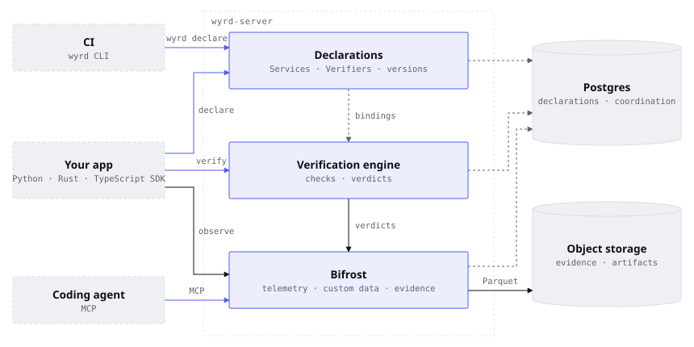

<p align="center">
  <a href="https://docs.bohmian.ai/wyrd/"></a>
</p>

<p align="center">
  <a href="https://github.com/bohmian-ai/wyrd/actions/workflows/lints-test.yml"></a>
  <a href="https://pypi.org/project/wyrd-ai/"></a>
  <a href="https://www.npmjs.com/package/wyrd-ai"></a>
  <a href="LICENSE.md"></a>
  <a href="https://discord.gg/K5bf23yPNb"></a>
</p>

<p align="center">
  <a href="https://docs.bohmian.ai/wyrd/"><b>Documentation</b></a> ·
  <a href="https://docs.bohmian.ai/wyrd/get-started/quickstart/">Quickstart</a> ·
  <a href="https://discord.gg/K5bf23yPNb">Discord</a>
</p>

Wyrd is open-source verification infrastructure for AI systems. Know whether your AI system does what you said it would, before release and in production.

You declare what your system must do as requirements. Your app sends Wyrd what it did, and Wyrd returns a verdict for each requirement, keeping it with the exact versions it judged. Check a support agent's answers, an uploaded document against your policy, or every step of a long-running workflow.

## How Wyrd fits your stack

<picture>
  <source media="(prefers-color-scheme: dark)" srcset=".github/assets/wyrd-stack-dark.svg">
  
</picture>

1. **Declare.** Describe what you ship in YAML and bind Verifiers to it, from CI with `wyrd declare` or from your code. Each declaration has a version, so a changed prompt is a new version.
2. **Observe.** Your app sends Bifrost, Wyrd's data plane, everything it produces as it runs: telemetry, its own data, and the evidence it submits to verify. Bifrost keeps all of it queryable with SQL beside every verdict.
3. **Verify.** Your app sends a result to a Verifier and gets a verdict for each requirement, with a reason.

The Python, Rust, and TypeScript SDKs, the CLI, MCP, and HTTP all call one server, so a verdict reads the same from each. [Architecture](https://docs.bohmian.ai/wyrd/understand/architecture/) shows what a team deployment runs.

## Install

You need PostgreSQL 16 and one of Python 3.11, Rust 1.95, or Node.js 22.18, on macOS (Apple silicon) or Linux.

```bash
# Python
uv add "wyrd-ai==0.3.0"

# Rust
cargo install wyrd-cli --version 0.3.0 --locked
cargo add wyrd-ai@0.3.0 tokio --features tokio/full

# TypeScript
pnpm add wyrd-ai@0.3.0
```

Start a local server with `wyrd init` (`uv run wyrd init` or `pnpm wyrd init`), or let your coding agent do it with `wyrd init guided`. [Set up Wyrd](https://docs.bohmian.ai/wyrd/get-started/setup/) has the details.

## Example

Declare one requirement: a support answer never promises a guaranteed refund.

<!-- example: examples/quickstart/no-refund-promise.yaml -->
```yaml
# The Verifier: a support answer never promises a guaranteed refund.
apiVersion: wyrd/v1
kind: Verifier
metadata:
  name: no-refund-promise
  version: 1.0.0
spec:
  inputs:
    answer: { type: json }
  requirements:
    - id: no-refund-promise
      statement: The answer never promises a guaranteed refund
      check:
        kind: assert
        path: inputs.answer
        operator: not_contains
        expected: guaranteed refund
```

Bind it to the Service it checks:

<!-- example: examples/quickstart/support-reply.yaml -->
```yaml
# The subject: your support agent's Service, verified by no-refund-promise.
apiVersion: wyrd/v1
kind: Service
metadata:
  name: support-reply
  version: 1.0.0
spec:
  verified_by:
    - verifier: ./no-refund-promise.yaml
```

Then verify two answers:

<details open>
<summary><b>Python</b></summary>

<!-- example: examples/quickstart/quickstart.py -->
```python
from wyrd import WyrdState

# Declare the Service and the Verifier it references, and get a ready state.
state = WyrdState.declare("support-reply.yaml")
run = state.run()

for answer in ("Your refund request is approved.", "You have a guaranteed refund."):
    result = run.observe.verify("no-refund-promise", answer=answer)
    print(f"{result.verdict}: {result.requirements[0]['reason']}")
    print(f"  subject:  {result.subject}")
    print(f"  verifier: {result.verifier}")
```

</details>

<details>
<summary><b>Rust</b></summary>

<!-- example: examples/quickstart/quickstart.rs -->
```rust
//! The docsite Quickstart in Rust: declare a Service and the Verifier it
//! references, then judge a passing and a failing answer.

use wyrd_ai::WyrdError;
use wyrd_ai::serde_json::json;
use wyrd_ai::state::WyrdState;

/// Declares `support-reply.yaml` from the working directory, verifies two
/// answers against `no-refund-promise`, and prints each verdict with its reason
/// and the exact subject and Verifier identities.
///
/// # Errors
///
/// Returns the [`WyrdError`] of a refused declaration or verification.
#[tokio::main]
async fn main() -> Result<(), WyrdError> {
    // Declare the Service and the Verifier it references, and get a ready state.
    let state = WyrdState::declare("support-reply.yaml").await?;
    let run = state.run();

    for answer in [
        "Your refund request is approved.",
        "You have a guaranteed refund.",
    ] {
        let result = run
            .observe()
            .verify("no-refund-promise", json!(answer))
            .await?;
        let reason = &result.outcome.requirements[0].reason;
        println!("{}: {reason}", result.outcome.verdict);
        println!("  subject:  {}", result.subject);
        println!("  verifier: {}", result.verifier);
    }
    Ok(())
}
```

</details>

<details>
<summary><b>TypeScript</b></summary>

<!-- example: examples/quickstart/quickstart.ts -->
```typescript
import { type CardRef, WyrdState } from "wyrd-ai";

// Declare the Service and the Verifier it references, and get a ready state.
const state = await WyrdState.declare("support-reply.yaml");
const run = state.run();

const id = (ref: CardRef) => `${ref.kind}/${ref.name}@${ref.version}#${ref.uid}`;
for (const answer of ["Your refund request is approved.", "You have a guaranteed refund."]) {
  const result = await run.observe.verify("no-refund-promise", { answer });
  console.log(`${result.outcome.verdict}: ${result.outcome.requirements[0].reason}`);
  console.log(`  subject:  ${id(result.subject)}`);
  console.log(`  verifier: ${id(result.verifier)}`);
}
```

</details>

Every language prints one passing and one failing verdict, each naming the exact versions it checked:

```text
passed: the comparison held
  subject:  Service/support-reply@1.0.0#<uid>
  verifier: default/Verifier/no-refund-promise@1.0.0#<uid>
failed: operator NotContains returned false
  subject:  Service/support-reply@1.0.0#<uid>
  verifier: default/Verifier/no-refund-promise@1.0.0#<uid>
```

[Run your first verification](https://docs.bohmian.ai/wyrd/get-started/quickstart/) walks through it. A check can also run Python or ask a model to judge; see [Write a Verifier](https://docs.bohmian.ai/wyrd/build-and-verify/verify/author-a-verifier/).

## Where Wyrd stops

Wyrd verifies your system; your code runs it. Your app owns its code, models, and data, and decides what to do with a verdict. Wyrd is not an application runtime, model host, training framework, or general-purpose code executor.

## Contributing

Read [CONTRIBUTING.md](CONTRIBUTING.md) before a substantial change. Ask questions on [Discord](https://discord.gg/K5bf23yPNb), and report vulnerabilities privately through [SECURITY.md](SECURITY.md).

## License

[Apache License 2.0](LICENSE.md).
