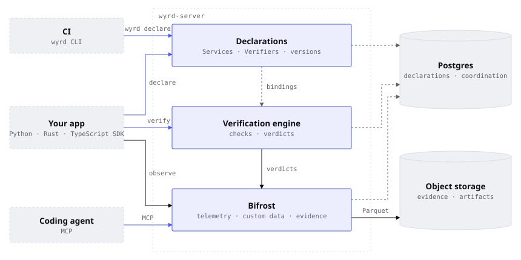

<p align="center">
  <a href="https://docs.bohmian.ai/wyrd/"></a>
</p>

<p align="center">
  <a href="https://github.com/bohmian-ai/wyrd/actions/workflows/lints-test.yml"></a>
  <a href="https://pypi.org/project/wyrd-ai/"></a>
  <a href="https://www.npmjs.com/package/wyrd-ai"></a>
  <a href="LICENSE.md"></a>
  <a href="https://discord.gg/K5bf23yPNb"></a>
</p>

<p align="center">
  <a href="https://docs.bohmian.ai/wyrd/"><b>Documentation</b></a> ·
  <a href="https://docs.bohmian.ai/wyrd/get-started/quickstart/">Quickstart</a> ·
  <a href="https://discord.gg/K5bf23yPNb">Discord</a>
</p>

Wyrd is open-source infrastructure for building your own verification system for AI/ML in production. Register what you ship at exact versions, record what it does, and judge that behavior with checks you compose: a one-line assertion, a model judge that cites your policy document, or a check across a six-hour agent run.

Your app sends Wyrd what it did. Wyrd returns a verdict for each requirement, with a reason, and keeps it beside the exact versions it judged. Start from a use case:

<p align="center">
  <a href="https://docs.bohmian.ai/wyrd/get-started/what-can-i-build/#policy-verification"></a>
  <a href="https://docs.bohmian.ai/wyrd/get-started/what-can-i-build/#agent-evaluation"></a>
  <a href="https://docs.bohmian.ai/wyrd/get-started/what-can-i-build/#long-horizon-workflows"></a>
  <a href="https://docs.bohmian.ai/wyrd/get-started/what-can-i-build/#runtime-verification"></a>
  <a href="https://docs.bohmian.ai/wyrd/get-started/what-can-i-build/#observability"></a>
  <a href="https://docs.bohmian.ai/wyrd/get-started/what-can-i-build/#drift-monitoring"></a>
</p>

[What can I build?](https://docs.bohmian.ai/wyrd/get-started/what-can-i-build/) walks through each one. They are examples: the same primitives build any verification you need.

## How Wyrd fits your stack

<picture>
  <source media="(prefers-color-scheme: dark)" srcset=".github/assets/wyrd-stack-dark.svg">
  
</picture>

1. **Declare.** Describe what you ship in YAML and bind Verifiers to it, from CI with `wyrd declare` or from your code. Each declaration has a version, so a changed prompt is a new version.
2. **Observe.** Your app sends Bifrost, Wyrd's data plane, everything it produces as it runs: telemetry, its own data, and the evidence it submits to verify. Bifrost keeps all of it queryable with SQL beside every verdict.
3. **Verify.** Your app sends a result to a Verifier and gets a verdict for each requirement, with a reason.

The Python, Rust, and TypeScript SDKs, the CLI, MCP, and HTTP all call one server, so a verdict reads the same from each. [Architecture](https://docs.bohmian.ai/wyrd/understand/architecture/) shows what a team deployment runs.

## Why Wyrd

Most AI tools hand you their evaluators, their UI, and their datastore. Your checks end up shaped by what the product supports, and your evidence lives where the product keeps it.

Wyrd gives you the primitives instead, and you build the verification layer your system needs: a code reviewer that reads the diff and your style guide, a payment check that cites your policy document, drift on a classical model, a check across a six-hour agent run.

| You get | So you don't have to |
| --- | --- |
| Verification primitives you compose into steps and checks | Fit your rules into one vendor's evaluator types |
| Checks as versioned YAML in your repo, run in CI, inline, in the background, per session, or on a schedule | Keep one set of evals for CI and another for production |
| One data plane for telemetry, model calls, your app's rows, and verdicts, as Iceberg tables in your object store, queried with SQL | Join evidence across four tools' stores and APIs |
| Registration and versioning for the whole service: agents, prompts, models, data, MCP servers | Guess which version produced a result |
| An LLM gateway and service identity, so every call and verdict names the account and release behind it | Bolt attribution on after the fact |
| Apache 2.0 and self-hosted, ingesting standard OpenTelemetry (OTLP) from any exporter | Re-instrument your app with a vendor SDK, or send your data to someone else's cloud |

## Install

You need PostgreSQL 16 and one of Python 3.11, Rust 1.95, or Node.js 22.18, on macOS (Apple silicon) or Linux.

```bash
# Python
uv add "wyrd-ai==0.4.1"

# Rust
cargo install wyrd-cli --version 0.4.1 --locked
cargo add wyrd-ai@0.4.1 tokio --features tokio/full

# TypeScript
pnpm add wyrd-ai@0.4.1
```

Start a local server with `wyrd init` (`uv run wyrd init` or `pnpm wyrd init`), or let your coding agent do it with `wyrd init guided`. [Set up Wyrd](https://docs.bohmian.ai/wyrd/get-started/setup/) has the details.

## Example

Declare one requirement: a support answer never promises a guaranteed refund.

<!-- example: examples/quickstart/no-refund-promise.yaml -->
```yaml
# The Verifier: a support answer never promises a guaranteed refund.
apiVersion: wyrd/v1
kind: Verifier
metadata:
  name: no-refund-promise
  version: 1.0.0
spec:
  inputs:
    answer: { type: json }
  requirements:
    - id: no-refund-promise
      statement: The answer never promises a guaranteed refund
      check:
        kind: assert
        path: inputs.answer
        operator: not_contains
        expected: guaranteed refund
```

Bind it to the Service it checks:

<!-- example: examples/quickstart/support-reply.yaml -->
```yaml
# The subject: your support agent's Service, verified by no-refund-promise.
apiVersion: wyrd/v1
kind: Service
metadata:
  name: support-reply
  version: 1.0.0
spec:
  verified_by:
    - verifier: ./no-refund-promise.yaml
```

Then verify two answers:

<details open>
<summary><b>Python</b></summary>

<!-- example: examples/quickstart/quickstart.py -->
```python
from wyrd import WyrdState

# Declare the Service and the Verifier it references, and get a ready state.
state = WyrdState.declare("support-reply.yaml")
run = state.run()

for answer in ("Your refund request is approved.", "You have a guaranteed refund."):
    result = run.observe.verify("no-refund-promise", answer=answer)
    print(f"{result.verdict}: {result.requirements[0]['reason']}")
    print(f"  subject:  {result.subject}")
    print(f"  verifier: {result.verifier}")
```

</details>

<details>
<summary><b>Rust</b></summary>

<!-- example: examples/quickstart/quickstart.rs -->
```rust
//! The docsite Quickstart in Rust: declare a Service and the Verifier it
//! references, then judge a passing and a failing answer.

use wyrd_ai::WyrdError;
use wyrd_ai::serde_json::json;
use wyrd_ai::state::WyrdState;

/// Declares `support-reply.yaml` from the working directory, verifies two
/// answers against `no-refund-promise`, and prints each verdict with its reason
/// and the exact subject and Verifier identities.
///
/// # Errors
///
/// Returns the [`WyrdError`] of a refused declaration or verification.
#[tokio::main]
async fn main() -> Result<(), WyrdError> {
    // Declare the Service and the Verifier it references, and get a ready state.
    let state = WyrdState::declare("support-reply.yaml").await?;
    let run = state.run();

    for answer in [
        "Your refund request is approved.",
        "You have a guaranteed refund.",
    ] {
        let result = run
            .observe()
            .verify("no-refund-promise", json!(answer))
            .await?;
        let reason = &result.outcome.requirements[0].reason;
        println!("{}: {reason}", result.outcome.verdict);
        println!("  subject:  {}", result.subject);
        println!("  verifier: {}", result.verifier);
    }
    Ok(())
}
```

</details>

<details>
<summary><b>TypeScript</b></summary>

<!-- example: examples/quickstart/quickstart.ts -->
```typescript
import { type CardRef, WyrdState } from "wyrd-ai";

// Declare the Service and the Verifier it references, and get a ready state.
const state = await WyrdState.declare("support-reply.yaml");
const run = state.run();

const id = (ref: CardRef) => `${ref.kind}/${ref.name}@${ref.version}#${ref.uid}`;
for (const answer of ["Your refund request is approved.", "You have a guaranteed refund."]) {
  const result = await run.observe.verify("no-refund-promise", { answer });
  console.log(`${result.outcome.verdict}: ${result.outcome.requirements[0].reason}`);
  console.log(`  subject:  ${id(result.subject)}`);
  console.log(`  verifier: ${id(result.verifier)}`);
}
```

</details>

Every language prints one passing and one failing verdict, each naming the exact versions it checked:

```text
passed: the comparison held
  subject:  Service/support-reply@1.0.0#<uid>
  verifier: default/Verifier/no-refund-promise@1.0.0#<uid>
failed: operator NotContains returned false
  subject:  Service/support-reply@1.0.0#<uid>
  verifier: default/Verifier/no-refund-promise@1.0.0#<uid>
```

[Run your first verification](https://docs.bohmian.ai/wyrd/get-started/quickstart/) walks through it. This assertion is the simplest check. A Verifier can also run Python, judge with an Agent that reads your uploaded policy files and cites them, judge a whole session, or watch for drift on a schedule; see [What can I build?](https://docs.bohmian.ai/wyrd/get-started/what-can-i-build/) and [Recipes](https://docs.bohmian.ai/wyrd/build-and-verify/verify/verifier-recipes/).

## Already have tools?

Keep them. Add Wyrd where they stop.

| You use | Keep it for | Add Wyrd for |
| --- | --- | --- |
| MLflow, W&B | Training, experiments, model registry | Runtime monitoring and verification of the model you deployed, at its exact version |
| Langfuse, Phoenix, LangSmith | Trace exploration, prompt iteration | Your own verification layer: checks you compose, judges with tools and your files, verdicts your app acts on |
| promptfoo, DeepEval, Ragas | Test suites and red-teaming in CI | Running the same checks on live traffic, and keeping every result |
| Evidently, Fiddler | Drift reports and dashboards | Drift judged next to traces, model calls, and app data, in one SQL store |
| LiteLLM, Portkey | Model routing, inline guardrails | Tying every call to an account, a release, and a verdict |
| Datadog, Grafana, Honeycomb | Infrastructure monitoring and alerts | Pass/fail verdicts on the same OpenTelemetry data |
| Credo AI, watsonx.governance | AI inventory, policy programs | Proof from production for each control |

## Where Wyrd stops

Wyrd verifies your system; your code runs it. Your app owns its code, models, and data, and decides what to do with a verdict. Wyrd is not an application runtime, model host, training framework, or general-purpose code executor.

## Contributing

Read [CONTRIBUTING.md](CONTRIBUTING.md) before a substantial change. Ask questions on [Discord](https://discord.gg/K5bf23yPNb), and report vulnerabilities privately through [SECURITY.md](SECURITY.md).

## License

[Apache License 2.0](LICENSE.md).
