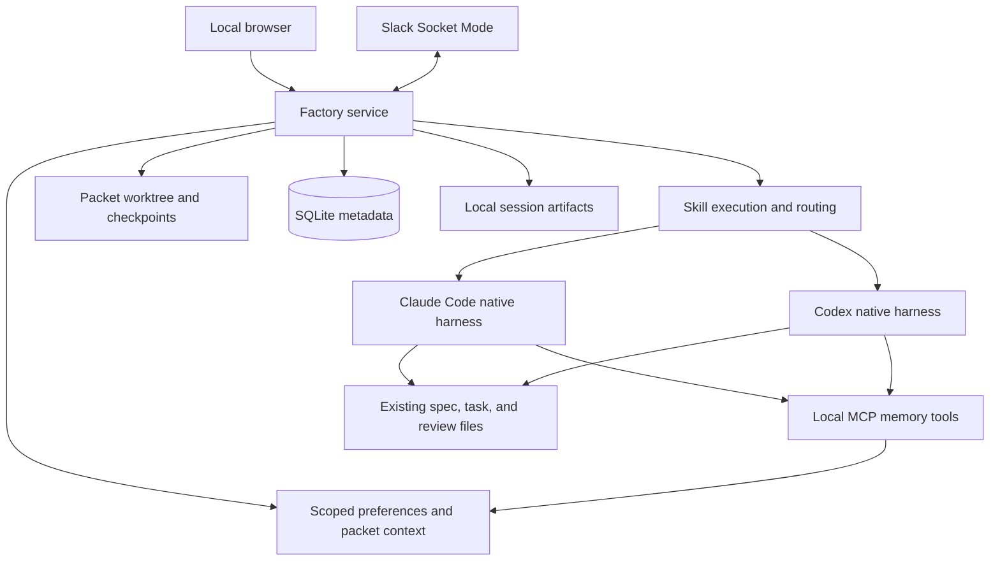

# Local software factory

## Problem and proposed behavior

The maintainer already has skills for specification, planning, implementation,
and independent review. Executing a packet still requires manually launching
Claude Code and Codex, forwarding remediation, tracking progress, recovering
sessions, and repeating preferences. Conversation compaction loses useful
context, and an agent's completion claim is easy to confuse with task approval.

Build a local application that operates those skills. The maintainer imports a
packet or drafts one in the application, approves its specification, and starts
execution. Claude Code implements; a fresh Codex session orchestrates review.
Review-produced remediation returns directly to implementation. Only the
existing review skill's PASS advances the task. Questions and material changes
return to the maintainer through the browser or Slack.

Before: the maintainer copies a remediation task into another agent session.
After: the application starts that handoff, retains the original task and prior
candidate, and shows the resulting activity and verdict.

The maintainer explicitly approved specification revision 2 on 2026-11-08.
The accompanying tasks reference that approved revision. Approval records the
design contract; it does not start implementation or authorize Git delivery.

## Scope and product boundary

The implementation is a standalone contributor application under
`tools/wyrd-factory/`, with its own package and frozen dependency lockfile.
It can manage trusted local Git repositories, including this repository. It
does not become part of wyrd-server, the Wyrd UI, Skald, Vala, or any SDK. It
does not require Wyrd Postgres, Cards, Bifrost, or a Wyrd server to operate.
The user's instruction to ignore current product conventions applies to this
separate application's stack; the managed repository's rules still apply when
its agents work there.

Version 1 serves one maintainer on one machine. Multiple repositories may be
registered, but only one agent attempt is active globally. A review skill may
delegate its own subagents; those remain part of that attempt. Tasks within a
packet execute in dependency order. This avoids introducing concurrent writers
and resource contention before there is evidence they are useful.

Out of scope: a custom coding-agent loop, replacement skills, another acceptance
or review framework, distributed workers, autonomous specification approval,
automatic production deployment, a vector database, model training, and public
hosting. Push and merge automation are also excluded from version 1. The UI
provides the branch and candidate for the maintainer to deliver normally.

## Architecture and ownership

Use TypeScript and Node.js, Fastify for the local service, React and Vite for
the browser application, SQLite through better-sqlite3 for metadata, and Git
worktrees for packet workspaces. The service serves the built UI. Browser
actions use HTTP; progress uses server-sent events. A disconnected browser
does not own or terminate execution.

Use the official Claude Agent SDK for TypeScript to operate Claude Code, and
Codex app-server over stdio to operate Codex. Use Bolt for JavaScript and
Socket Mode for Slack. Pin supported package, tool, and model versions in the
implementation and record the resolved versions per attempt. These choices
reuse the native harnesses rather than reconstructing their tool loops.

Expose shared memory through a local MCP interface attached to both native
harnesses. Its tools call the existing factory context/memory owner and SQLite
store; they do not introduce a second database or memory service. A local stdio
entrypoint forwards to the running service with an attempt-bound credential.
The service remains the only metadata writer.

| Owner | Responsibility |
|---|---|
| Existing skills | Specify, plan, implement, verify, delegate reviewers, validate findings, and issue their existing results |
| Factory service | Launch attempts, persist state, manage worktrees, route results, deliver feedback, and expose decisions |
| Native agent integrations | Authentication, native sessions, tool permissions, delegation, streaming, and interruption |
| Local MCP memory tools | Scoped live context, additional retrieval, and agent-authored packet notes through the existing service |
| SQLite | Execution metadata, messages, decisions, preferences, and ordered audit events |
| Packet files and Git | Specification, tasks, implementation evidence, review reports, and immutable candidates |
| Browser and Slack | Two interfaces to the same service actions and pending decisions |

The factory does not copy packet contents into a second editable contract.
Metadata references the files and records the content hashes actually supplied
to an attempt. Context snapshots and redacted transcripts live outside managed
repositories, beneath `WYRD_FACTORY_HOME` (default `~/.wyrd-factory`).

Persist repositories, packets, task references/dependencies, attempts, messages,
decisions, preferences, and ordered events. An attempt records its role, skill
path/hash, native session ID, actual model/effort/tool versions, input context,
candidate identity, result, artifact paths, timestamps, and reported usage.
Use migrations and SQLite transactions; do not introduce an event-sourcing
framework or external queue.

## Required behavior

### Authoring and native sessions

- **REQ-001 — Existing packet lifecycle.** Register a repository and import its
  `changes/active/<slug>/` packet. Alternatively invoke wyrd-spec from an intent,
  display the draft, record explicit approval of the exact revision/content,
  and invoke wyrd-plan. Present proposed tasks for the maintainer to start.
  Reject missing authority, duplicate task IDs, missing dependencies, and
  dependency cycles. Editing approved material returns it to draft; affected
  execution waits for renewed approval. Ordinary editing uses the packet files.
- **REQ-002 — Native execution.** Run only Claude Code and Codex for agent
  work, initially Claude for authoring/planning/implementation and Codex for
  review. Resolve skills from the managed repository's configured paths. Keep
  native subagent delegation, permissions, and resumable sessions available.
  Preflight executable, authentication, and required capabilities before
  dispatch. Missing delegation blocks a skill that requires it. Do not scrape
  terminal rendering or call raw model APIs to replace either native harness.
- **REQ-003 — Local interface.** Provide packet creation/import, task order and
  status, session output, the candidate diff, evidence/report links, a pending
  decision inbox, and execution controls. Show observed stage and verdict;
  do not manufacture percentage completion. The service works with no browser
  connected, and reconnecting reads persisted state plus later events.

### Handoffs, candidates, and evidence

- **REQ-004 — Skill-owned routing.** IMPLEMENTED from wyrd-implement starts
  wyrd-task-review. Review PASS advances to the next eligible original task;
  FIX_REQUIRED routes its actual remediation task directly to wyrd-implement;
  BLOCKED and SPEC_REVISION_REQUIRED suspend affected execution and expose the
  exact question/conflict. Never replace skill verdicts with prose inference.
  After all original tasks pass, run the repository's existing final
  change-review/completion workflow when configured. Otherwise label the
  packet "task reviews passed; final review pending". Do not claim integrated
  approval merely from task PASS results. Preserve completion artifacts if the
  final skill removes the active packet.
- **REQ-005 — Git subject.** Create one factory-owned branch/worktree per
  packet from the maintainer-selected clean committed base. Refuse to discard
  dirty input or overwrite an existing branch/worktree. Starting execution
  explicitly authorizes checkpoint commits on that factory branch using the
  configured Git identity. Stop implementation before checkpointing. Record
  unambiguous base/candidate commits before review. Reviews may write their
  designated reports but must not change the reviewed source. Source mutation
  invalidates the attempt. Remediation receives the original task, prior
  candidate/verdict, remediation path, and cumulative candidate. Do not push,
  merge, reset the maintainer's checkout, or silently adopt external edits.
- **REQ-006 — Evidence inspection and CI.** Display implementation evidence
  and review files without reimplementing their acceptance checks. Normalize a
  small result envelope containing the native status, task/report/remediation
  paths, candidate, question, and handoff note. Validate required artifacts and
  candidate identity before routing. Missing, malformed, contradictory, stale,
  or escaped paths cannot advance execution. Offer explicit read-only GitHub
  check refresh through the installed gh CLI for a selected commit; show
  failed, pending, unavailable, and stale results separately. Local-only
  commits legitimately have no CI result. CI display never substitutes for a
  skill's required verification or verdict.

### Control, continuity, and memory

- **REQ-007 — Durable control and recovery.** Persist attempts before launch
  and transitions with their audit event atomically. Support pause, resume,
  cancel, retry, and fresh-session replacement. Pause requests interruption and
  prevents the next dispatch; show "pausing" until termination is confirmed.
  Cancellation preserves files and history and stops dispatch. Retry creates
  a new attempt. On service restart reconcile surviving processes before any
  writer starts. Unknown ownership remains interrupted and requires an
  explicit resolution; timeout or missing heartbeat is not proof of exit.
  A second service instance cannot dispatch against the same state directory.
- **REQ-008 — Context and feedback.** Persist feedback before delivery and
  record pending/delivered/uncertain delivery. Do not automatically resend
  uncertain feedback after a crash. Resume a compatible implementation
  session when useful; fresh sessions receive the actual task, current
  candidate, review/remediation paths, decisions, applicable preferences, and
  available handoff note. A handoff's assertions are not verification facts.
  Every review starts in a fresh session, independent of implementation.
  Native lifecycle events are primary; hooks supply missing session-start,
  pre-compaction checkpoint, post-compaction refresh, and stop/failure
  integration only where needed. Supply critical instructions directly at
  session start and again after compaction; refresh current task references,
  applicable preferences, decisions, and checkpoint from the same context owner.
  Instruct the agent to use factory_context at start/resume/after compaction
  and memory_search when additional history is needed. Tool availability alone
  is not proof of refresh: record the supplied baseline and subsequent tool
  results. Demonstrate a supported refresh mechanism for each native harness;
  a missing mechanism is a capability blocker, not a successful recovery based
  only on a pre-compaction note. Native compaction remains available. A missing
  handoff never loses persisted execution state or turns incomplete work into
  approval.
- **REQ-009 — Explicit personal memory.** Feedback defaults to task scope.
  The maintainer may explicitly remember it for the repository or globally.
  Store provenance and allow edit, disable, supersede, and delete. Both agents
  receive the same applicable enabled preferences, with repository-specific
  entries overriding general preferences on the same subject. Repository
  authority and approved outcomes remain stronger than general preferences;
  unresolved material conflict becomes a decision. Agents may propose memory
  but never promote it silently. Include applicable explicit preferences and
  unresolved decisions; retrieve older notes by scope/tags/full-text search
  within a documented context budget, retaining links to omitted material.
  Record the actual context supplied. No vector store or hidden personality
  profile is required.
- **REQ-014 — Shared callable memory.** Attach factory_context, memory_search,
  and memory_record to Claude Code and Codex through local MCP, including the
  applicable scope for delegated agents. Bind repository, packet, task,
  attempt, and role at connection creation; callers cannot select another
  packet or elevate their role by supplying identifiers. Return bounded
  structured results with provenance, record IDs, and references to further
  material. Log supplied results and successful writes. Writes are attributable
  to the bound agent and are packet-scoped; only the maintainer can promote a
  suggested preference to repository/global authority. Agent notes cannot
  overwrite workflow state, specification approval, candidate identity, or
  verdicts. Ended attempts cannot continue using their connection. Memory
  unavailable or writes unacknowledged must be reported honestly; never claim
  a saved checkpoint without a successful write. Initial independent review
  context excludes implementor checkpoints and unverified implementation
  narratives; explicit maintainer decisions and required task/review evidence
  remain available according to the review skill's scope.

The tool contract is intentionally small:

| Tool | Input | Result and permitted effects |
|---|---|---|
| factory_context | No arguments | Current original task/spec references, candidate, review/remediation references, applicable approved preferences, packet decisions, and the role-appropriate latest checkpoint. Read-only. |
| memory_search | query: nonempty text | Relevant permitted global/repository preferences and packet notes with source, scope, author, and asserted/verified distinction. Read-only; scope derives from the connection. |
| memory_record | content: nonempty text; kind: note, discovery, or checkpoint | Persist an agent-authored packet record and return its ID. A checkpoint describes attempted/unfinished work, next action, and relevant files; it is not verified progress. |

Use the same context result for direct baseline injection and on-demand calls.
Context snapshots/files remain inspection and recovery artifacts, not a second
editable memory source. Do not require a model to call a tool before it receives
the critical instructions needed to use it correctly.

### Remote oversight and operation

- **REQ-010 — Slack oversight.** Optional Socket Mode connects one configured
  workspace/user/channel to packet threads. Send stage milestones and pending
  decisions; accept feedback, pause/resume, and answers through the same
  service actions as the UI. Deduplicate delivery and reject unauthorized,
  expired, resolved, or obsolete decisions. Slack text is data, never a shell
  command. Slack outage must not prevent local use; queue unsent milestones
  and clearly expose disconnected/delivery-failed state. Acknowledgment means
  receipt, not successful execution. Never include credentials or raw source
  in automatic notifications; the maintainer explicitly chooses shared text.
- **REQ-011 — Accountability and local access.** Record attempts, handoffs,
  candidate identities, verdicts, control actions, feedback delivery, and
  approval actors. Redact configured secret values before persistence and
  streaming. Listen on loopback, protect mutations and streams with a local
  session and origin/host validation, and protect local data with owner-only
  access. Keep native tool permission handling; route permission requests to
  the UI instead of globally bypassing approvals. Credentials use native
  agent login/key mechanisms; Slack tokens are supplied through local
  environment/configuration outside tracked files. This trusted-local-user
  application is not a hostile-code sandbox or tamper-proof audit service.
- **REQ-012 — Bounded unattended work.** Limit one active attempt globally,
  including across packets. Default attempt wall time is 45 minutes; default
  automatic remediation ceiling is four rounds. Both are visible/editable
  before execution. Preserve the review skill's convergence assessment after
  two failed remediation reviews. Exhaustion interrupts/pauses and asks the
  maintainer to extend or stop; it never grants PASS or invents a finding.
  Show reported usage and distinguish actual from estimated/unknown cost.
- **REQ-013 — Install, backup, and portability.** Provide mise entrypoints for
  install, development, built-service start, checks, tests, and explicit live
  smoke verification. Support macOS arm64 and Linux x86_64/arm64 with the same
  behavior. Dependency/tool pinning and native SQLite installation must be
  demonstrated on these platforms before claiming support. Closing a browser
  must not stop the service; host sleep/offline pauses availability. Provide a
  quiescent backup/restore action for SQLite, session artifacts, packet
  workspaces, and their Git history without secret export by default. Refuse
  backup/restore while an attempt may still write. Validate a restored set in
  a separate state directory before permitting dispatch.

## Invariants

- **INV-001:** Only explicit maintainer approval authorizes a specification
  revision; drafting or agent agreement never does.
- **INV-002:** Native skills own implementation evidence and verdicts; the
  factory never self-approves or simulates required independent reviewers.
- **INV-003:** Acceptance belongs to the recorded original task and immutable
  candidate. Changed source, authority, or task content cannot inherit a
  stale approval without the applicable skill reconsidering it.
- **INV-004:** No replacement writer starts until the previous writer and its
  children are confirmed stopped; partial work is preserved on interruption.
- **INV-005:** Execution state survives loss of every conversation summary.
- **INV-006:** Untrusted network input cannot authorize actions, access local
  streams, execute commands, or export credentials.
- **INV-007:** Memory records explicit instructions with scope and provenance;
  inferred preferences cannot silently become authority.
- **INV-008:** Memory tools enforce bound scope/role and cannot approve work,
  overwrite controller facts, or carry implementation narratives into an
  independent review as established truth.

## Acceptance and evidence

| Acceptance | Required observation | Owning task |
|---|---|---|
| AC-001 | A browser user imports a packet and drafts/approves a spec and plans tasks through actual skill sessions; unapproved or invalid packets cannot start implementation. | TASK-001 |
| AC-002 | Both native harnesses stream a bounded skill session and demonstrate required delegation; missing auth/capabilities and denied permissions remain visible and cannot become success. | TASK-001 |
| AC-003 | A packet implements, fails review, remediates the generated task, passes review, and advances in dependency order without copied prompts; blockers and final-review-pending remain distinct. | TASK-002 |
| AC-004 | Base/candidate identities are stable; original-task and cumulative context survive remediation; changed source, stale results, missing artifacts, and escaped paths cannot advance work. | TASK-002 |
| AC-005 | Browser inspection displays the diff, evidence, event history, usage, and commit-specific CI success/failure/pending/unavailable/stale states without granting approval from them. | TASK-002 |
| AC-006 | Pause/cancel stop dispatch and preserve files; restart before/after launch, during review, and before transition never creates a duplicate writer or false PASS. | TASK-003 |
| AC-007 | Feedback survives restart with honest delivery state; fresh and compacted implementations receive current instructions/task/decision/checkpoint context without relying on a transcript, and every review is independent. | TASK-003, TASK-004 (MCP refresh) |
| AC-008 | Task feedback stays local; explicit repository/global preferences reach both agents in later tasks; disabling/deleting/superseding removes them from later context, with provenance visible. | TASK-004 |
| AC-009 | Slack and UI resolve the same decision once; duplicate, foreign, stale, and outage cases do not repeat actions or block local control. | TASK-005 |
| AC-010 | Foreign browser origins, unauthenticated streams, and credential-shaped log content are refused/redacted; native permission requests remain actionable. | TASK-001, TASK-005 (Slack boundary) |
| AC-011 | Time/round limits pause without approval, and recorded usage never labels an unknown cost as measured. | TASK-003 |
| AC-012 | A clean supported host can install/start the built application; a quiescent backup restores into separate state with its history and refuses uncertain writers. | TASK-001 (installation), TASK-003 (recovery/backup) |
| AC-013 | Both real native harnesses call the three MCP tools; notes survive session replacement, foreign/stale scope is refused, failed writes stay unacknowledged, and agent notes cannot change controller facts or independent review context. | TASK-004 |

Use Vitest for service/state/process integration and Playwright for browser
journeys against the real local factory service, SQLite, and temporary Git
repositories. Deterministic fake native processes test faults without billing;
they do not prove native authentication, skill loading, subagent delegation,
MCP tool availability, or actual compaction refresh.
Explicit live smoke journeys must exercise both real harnesses and the real
skills in a disposable fixture repository. Memory smoke must include actual
calls to all three tools and an observed compaction/refresh for each harness,
with a missing checkpoint case. Slack transport and GitHub CLI
fixtures pin their service boundaries; credentialed real-service smoke proves
the configured external integrations. Never send real messages or incur paid
agent work without an explicit smoke invocation.

The standalone factory's journeys exercise its own HTTP/browser/agent surfaces;
Wyrd SDK/Postgres journeys do not prove this separate application's behavior.
Tests run through mise. TASK-001 establishes new factory commands because no
factory package or test lane exists today. Later tasks use those commands;
planned selectors are confirmed against added tests before RED is recorded.

## Costs, alternatives, and research grounding

The application adds a Node dependency tree, a local SQLite data directory,
agent usage costs, native integration compatibility work, and optional Slack
administration. It cannot run while its host is asleep, guarantee perfect
review, enforce a precise dollar ceiling from delayed usage, or isolate
malicious shell code through a Git worktree. The maintainer remains responsible
for approving semantics and delivering the final branch.

Use official native harnesses and small durable handoffs because the existing
skills already own the development process. A new agent framework, distributed
scheduler, or semantic-memory service would duplicate responsibilities without
closing a version-1 gap. Existing AGENTS.md/CLAUDE.md and skill instructions
remain applicable; shared preferences supplement them.

- [Codex app-server](https://developers.openai.com/codex/app-server/): native
  sessions, event streaming, structured turns, interruption, and approvals.
- [Claude TypeScript SDK](https://code.claude.com/docs/en/agent-sdk/typescript):
  native harness integration, permissions, hooks, and session controls.
- [Codex MCP](https://developers.openai.com/codex/mcp/) and
  [Claude custom tools](https://code.claude.com/docs/en/agent-sdk/custom-tools):
  shared tools exposed through the native harnesses.
- [Effective harnesses for long-running agents](https://www.anthropic.com/research/effective-harnesses-for-long-running-agents)
  and [subsequent harness design](https://www.anthropic.com/research/harness-design-long-running-apps):
  incremental work, external handoffs, and separate evaluation.
- [Harness component study](https://arxiv.org/html/2609.20804v1) and
  [memory substrate evaluation](https://arxiv.org/html/2608.15008v2): evidence
  for measuring context additions rather than assuming more machinery helps.
- [Slack Socket Mode](https://docs.slack.dev/apis/events-api/using-socket-mode/)
  and [SQLite WAL](https://www.sqlite.org/wal.html): local integration choices.

These sources inform the design; their benchmark results do not establish
quality gains for this maintainer. Compare representative packets with the
manual workflow using intervention time, failed handoffs, remediation rounds,
escaped defects, elapsed time, and agent usage. Do not advertise improvement
without that evidence.

## Approval and revision history

There is no open material decision in this approved revision. Approval covers the
standalone location/stack, skill ownership, global serial execution, native
integrations, local MCP tool contract, compaction refresh, local trust model,
persistence/memory boundaries, Git checkpoint
authorization model, and the acceptance outcomes above. Package versions and
ordinary private implementation details remain implementation-owned.

| Revision | Status | Change |
|---|---|---|
| 1 | Draft | Initial proposal derived from the maintainer's factory request and architecture discussion; no human approval recorded. |
| 2 | Approved | Add shared MCP memory tools, bound scope/role, direct critical-context injection, post-compaction refresh, and native verification. Explicit maintainer approval recorded on 2026-11-08: "i approve the spec". |

## Authority links

- [Original request](../../../.dev/factory.md)
- [Spec-driven development](../../spec-driven-development.md)
- [Implementation execution](../../implementation-execution.md)
- [Testing map](../../../TESTING.md)
- [Wyrd doctrine boundary](../../../architecture/wyrd-design.md#doctrine)
- [wyrd-spec](../../../.agents/skills/wyrd-spec/SKILL.md)
- [wyrd-plan](../../../.agents/skills/wyrd-plan/SKILL.md)
- [wyrd-implement](../../../.agents/skills/wyrd-implement/SKILL.md)
- [wyrd-task-review](../../../.agents/skills/wyrd-task-review/SKILL.md)
